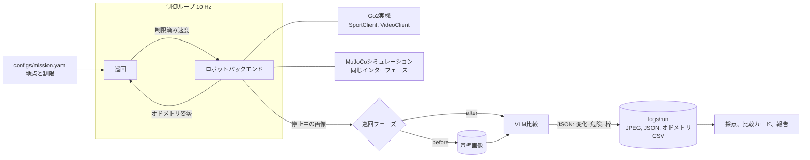

# Second Look: 変化を見つけるGo2

Unitree Go2が現場を2回巡回します。1回目は各地点の基準映像を保存します。2回目は視覚言語モデル(VLM)が新旧の映像を比較し、追加、除去、移動、転倒した物を報告します。ロボットは開始地点へ戻り、点検ログを書き出します。

想定用途は現場の再点検で、たとえば作業開始前の月面建設現場の確認です。これは目標であり、本プロジェクトで実証したのは実験室の模擬現場までです。

## 状況

| 項目 | 状態 |
|---|---|
| 巡回、安全制限、ログ、採点 | シミュレーションと実機で動作 |
| Go2バックエンド | 実機で巡回4回完了(`unitree_sdk2_python`、有線接続) |
| 手動操縦 | 実機で前進と旋回を確認。横移動とギア切替は未確認 |
| ローカルVLM(qwen3.6) | 実画像とシミュレーション画像で評価済み |
| Gemini比較 | シミュレーション画像のみ。実画像では未実行 |
| 手持ちリモコン停止 | **未検証** |

## 結果

実機(変更ありの巡回1回と変更なしの対照1回、計6地点、qwen3.6):

| 手法 | 地点数 | 正解 | 誤検出 | 見逃し |
|---|---|---|---|---|
| 前後比較 | 6 | 6 | 0 | 0 |
| 単一画像 | 6 | 3 | 0 | 3 |

正解既知の画像ペアは8件中8件が正解でした。変化の種類の完全一致は3地点中1地点、危険フラグは3地点中0地点です。帰還誤差はオドメトリで約0.1 mで、真の誤差は測定していません。VLMは巡回後に保存画像で実行しました。標本が少ないため、参考値として扱ってください。

シミュレーションの結果と限界は [docs/VLM_EVAL.md](docs/VLM_EVAL.md) にあります。

## 仕組み



設計上の判断:

- **移動はオドメトリで行います。** VLMの呼び出しには数秒かかるため、ロボットが停止している地点でのみ実行します。VLMの出力で動作を指令することはできません。
- **シミュレーションと実機で同じインターフェースを使います。** `scout/patrol.py` は両方でそのまま動きます。
- **失敗時は安全に停止します。** 速度はバックエンドで制限し、時間とステップの上限を毎回確認し、`finally` で `stop()` を実行します。VLMの失敗はログに残し、巡回は次の地点へ進みます。
- **ベースラインを備えています。** `scripts/revlm.py` は保存画像で単一画像の判定を行うため、前後比較を基準なしの判定と比較できます。

## 構成

| パス | 内容 |
|---|---|
| `configs/mission.yaml` | 地点、速度と時間の制限、モデル、シミュレーションのドリフト |
| `scout/robot.py` | Go2バックエンドと速度制限 |
| `scout/sim_robot.py` | スリップとオドメトリドリフト付きのMuJoCoバックエンド |
| `scout/patrol.py` | 経由点制御、ミッション監視、巡回手順 |
| `scout/vlm.py` | Gemini、Ollama、オフライン用モックの比較と応答の解析 |
| `scout/runlog.py` | 実行フォルダ: JPEG、`run.json`、`odom.csv` |
| `scout/align.py` | 再整列と、比較前の画像位置合わせ |
| `scout/recorder.py` | 動画用のカメラ記録。制御ループから分離 |
| `sim/` | MuJoCoの現場シーンとGo2モデル(BSD-3-Clause、`sim/assets/go2/` 参照) |
| `scripts/scan_to_mujoco.py` | Real2Sim: スキャンメッシュから衝突判定と経路付きのMuJoCoシーンを生成 |
| `scripts/` | 事前確認、Go2確認、巡回、再実行、採点、カード、点検ログ、動画のツール |
| `docs/` | 実験手順書、報告書、動画計画、チェックリスト、リハーサル、開発ブログ、追加実験の記録 |

## セットアップ

```bash
uv venv --python 3.10 .venv
git clone https://github.com/unitreerobotics/unitree_sdk2_python third_party_sdk
uv pip install --python .venv/bin/python -r requirements.txt -e third_party_sdk
.venv/bin/python -m pytest -q tests
```

Geminiの呼び出しは環境変数 `GEMINI_API_KEY` を読みます。キーは絶対にコミットしないでください。

## シミュレーションでの実行

```bash
.venv/bin/python scripts/run_patrol.py --backend sim --phase before --run sim_ref --video
.venv/bin/python scripts/run_patrol.py --backend sim --phase after --run sim_1 \
    --reference logs/sim_ref --change tower_fallen --seed 1
.venv/bin/python scripts/score.py logs/sim_1
.venv/bin/python scripts/make_cards.py logs/sim_1
```

変更の種類は `tower_fallen`、`rock_added`、`block_removed`、`block_moved` です。`--vlm ollama` でローカルモデルを使います。`--vlm mock` はAPIキーなしで動きますが、出力は画素差分でありVLMの結果ではありません。

実機の手順は [docs/LAB_RUNBOOK.md](docs/LAB_RUNBOOK.md) を参照してください。

## 手動操縦

`scripts/teleop.py` はライブカメラの画面を開き、Go2を手動で移動または回収するためのツールです。

```bash
.venv/bin/python scripts/teleop.py --view-only                    # カメラのみ、指令は送りません
.venv/bin/python scripts/teleop.py --remote-in-hand --gear 1      # 操縦。伏せている場合は --stand を追加
```

カメラ画面をクリックしてからキーを押し続けます。離すと停止します。

| キー | 動作 |
|---|---|
| W または ↑ | 前進 |
| S または ↓ | 後退(カメラは前向きなので後方は見えません) |
| A または ← | その場で左旋回 |
| D または → | その場で右旋回 |
| Q / E | 左 / 右へ横移動 |
| W + A または W + D | 歩きながら曲がる |
| 1 / 2 / 3 | 低速 / 中速 / 高速ギア |
| Space | 停止を保持 |
| R | 停止の保持を解除 |
| Esc | 停止して終了 |

| ギア | 前進 | 旋回 | 横移動 |
|---|---|---|---|
| 1 | 0.15 m/s | 0.4 rad/s | 0.10 m/s |
| 2(既定) | 0.20 m/s | 0.5 rad/s | 0.15 m/s |
| 3 | 0.30 m/s | 0.6 rad/s | 0.20 m/s |

画面がフォーカスを失う、画面が固まる、カメラ映像が古くなる、指令が失敗する場合もロボットは停止します。横移動は手動操縦専用で、巡回では使いません。ロボットに指令できるプログラムは1つだけなので、先に巡回を止めてください。本当の安全停止は手持ちリモコンですが、このプロジェクトでは未検証です。

## Real2Sim実験

`scripts/scan_to_mujoco.py` は色付きTSDFメッシュをMuJoCoシーンへ変換します。床を水平にし、メッシュを簡略化し、色をテクスチャへ焼き付け、未知の空間を障害物として扱う衝突用ハイトフィールドを作り、通行可能な巡回経路を計画します。`scripts/check_scan_scene.py` はGo2が衝突床の上に立つことを確認します。スキャンデータはこのリポジトリに含まれていません。

スキャンの品質が低いため、用途は配置と経路の確認に限られます。

## 謝辞

Unitree `unitree_sdk2_python`、MuJoCo、MuJoCo MenagerieのGo2モデル、Gemini API、Ollamaを使用しました。APIの利用方法は講座のサンプル「Gemini Robotics-ER 1.6 を試す」を出発点としています。本プロジェクトでは、実機での巡回、前後比較、正解ラベルに対する評価、シミュレーションでの故障試験を追加しました。
