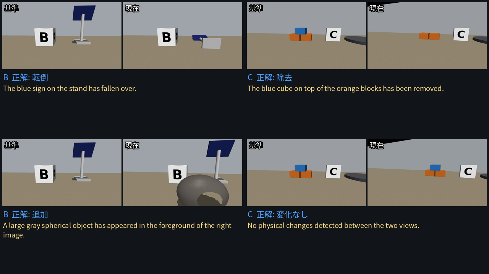

# Second Look: Go2と視覚言語モデルによる現場の再点検

## 1. 概要と目的

作業現場の地図や記録は、物が動くとすぐに古くなる。本プロジェクトでは、Unitree Go2が決められた地点を巡回し、各地点の現在の映像を保存済みの基準映像と視覚言語モデル(VLM)で比較して、何が変わったかを報告し、開始地点へ戻るシステムを構築した。

## 2. システム構成

ロボットのカメラとオドメトリ → PC上の巡回制御(固定の経由点、速度制限、異常時の停止) → 各地点で映像を保存 → VLMが基準映像と現在の映像を比較 → 点検ログを出力。VLMは保存された画像のみを読み、ロボットの動作を指令することはできない。

- ロボット: Unitree Go2 EDU。前方カメラ、スポートモードの速度指令、オドメトリを使用。PCと有線で接続
- AI: Ollamaでローカル実行したqwen3.6。学習は行わず推論のみ。Gemini Robotics ERはシミュレーション画像でのみ使用
- シミュレーション: MuJoCo。実機と同じ巡回コードを使用
- 現場: 3地点(サンドボックス、岩、ソーラーパネル)、経路は約2 m

## 3. 独自の取り組み

1. **移動ロボットによる前後比較点検。** 実機のGo2で巡回を4回完了した。1回で基準映像を保存し、1回は人が場面を変更した後に、1回は変更なしの対照として実行した。もう1回は旧経路の試走である。VLMの結果は、巡回後に保存画像から算出した。
2. **正解が分かる画像ペアによる入力形式の検証。** シミュレーションでは、2枚の画像を別々に渡すと変化を12件中12件検出したが、対照試験は12件中7件しか正解せず、モデルが主に地点ごとに同じ答えを返していたことが分かった。1枚の左右並べ画像に変更すると、対照試験は12件中12件正解した。
3. **正解ラベルに対する評価。** 単一画像、画素差分、学習済み検出器との比較を以下に示す。後の2つはシミュレーションのみである。
4. **シミュレーションでの故障試験。** 注入した13件の故障すべてで、停止指令を送りログを残して終了した。この試験で、経由点間の停止失敗が再試行されないという実際の不具合を発見した。
5. **シミュレーションと実機で同じコード。** シミュレーションで動かした巡回コードを、そのまま実機で実行した。

## 4. 結果

### 実機(変更ありの巡回1回と変更なしの対照1回、計6地点)

| 手法 | 地点数 | 正解 | 誤検出 | 見逃し |
|---|---|---|---|---|
| 前後比較 | 6 | 6 | 0 | 0 |
| 単一画像 | 6 | 3 | 0 | 3 |

実画像での正解既知ペア: 同一画像 3件中3件、入れ替え 3件中3件、別地点 2件中2件が正解。変化の種類が完全に一致したのは変化があった3地点中1地点、危険フラグが立ったのは3地点中0地点であった。

帰還誤差はオドメトリで3回の巡回について0.100、0.095、0.092 mであった。これらは0.10 mの停止条件付近の値であり、真の精度を示すものではない。真の帰還誤差は測定していない。

### シミュレーション(ドリフト水準ごとに未使用の18地点: 変化あり6、変化なし12)

ドリフト量は仮定値である。表は誤検出数を示す。どの手法も変化は6件中6件検出した。

| ドリフト | VLM | 学習済み検出器 | 画素差分 |
|---|---|---|---|
| 基準 | 3/12 | 5/12 | 12/12 |
| 2倍 | 7/12 | 6/12 | 12/12 |
| 4倍 | 9/12 | 11/12 | 12/12 |
| 8倍 | 9/12 | 11/12 | 12/12 |

4倍と8倍では対象物が視野から外れることがあるため、これらの検出は弱い根拠にとどまる。

図: MuJoCoシミュレーションの基準ドリフトでの例。上記の未使用データから選び、黄色の文はVLMの実際の英語の応答である。すべての結果を代表するものではない。

動画: [link](2倍速で表示)

## 5. 失敗事例

| 事例 | 原因 | 改善案 |
|---|---|---|
| 実機の地点B: 移動した岩を「追加」と「除去」と報告 | モデルが1回の移動を2つの出来事として報告した | 種類の語ではなく、物体と位置で評価する |
| 実機の地点C: ブロックの移動と報告、ラベルは除去 | 場面内で複数の物が変わり、要約が1つしか挙げなかった | 1地点につき変更は1物体にする |
| 実画像で危険フラグが3件中0件 | モデルの弱点。シミュレーションでも同様 | フラグではなく、報告された物体に対する規則を使う |
| 枠が対象物から外れる | モデルの弱点 | 枠を判断に使わない |
| シミュレーションで停止誤差とともに誤検出が増加 | 物体が画像の端から出入りする | 停止精度を上げる |

地点Aのラベルは、実行時に例示用のラベルを使っていたため、実行後に保存画像を見て「なし」から「追加」へ修正した。他の地点のラベルは変更していない。

## 5b. 追加実験: 部屋のスキャンからのReal2Sim

部屋のTSDFメッシュを、衝突用ハイトフィールド付きのMuJoCoシーンへ変換し、同じ巡回コードを実行した。シミュレーション内で箱を追加すると、VLMは3件中3件を検出し、誤検出は15件中0件であった。ただし3件はすべて同じ目立つ物体であり、スキャンも写実的ではないため、これは精度ではなくパイプラインの動作を示すものである。

## 6. 限界と想定用途

1つの実験室の模擬現場で、変更ありの巡回1回と対照1回のみを評価したものであり、実機の標本数は少ない。対照は最初の基準ではなく、変更後の巡回と比較した。手持ちリモコンによる停止は未検証で、端末からの停止にも記録が残っていない。経路の長さはケーブルにより制限される。月面建設現場の点検は想定用途であり、実証した結果ではない。

## 7. 今後の課題

1. 地点ごとに1つの変更を実行前に記録し、巡回回数を増やして再評価する。
2. 巻尺やモーションキャプチャで真の帰還誤差を測定する。
3. リモコン停止と通信断時の挙動を検証する。
